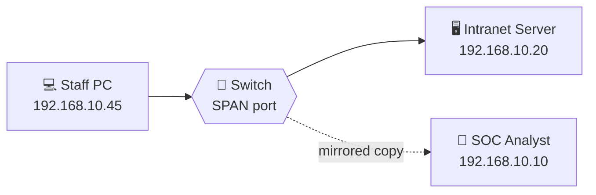
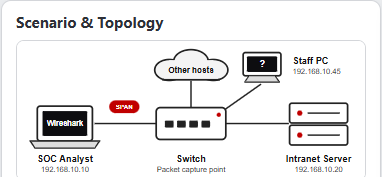
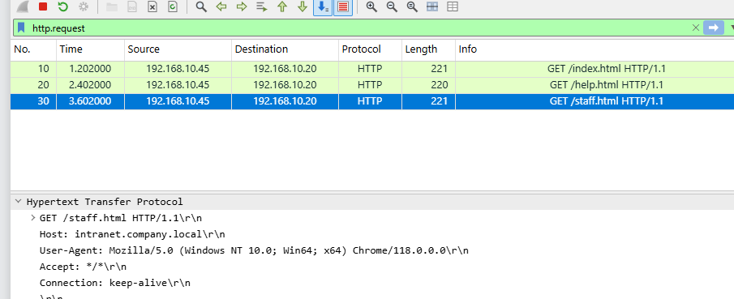
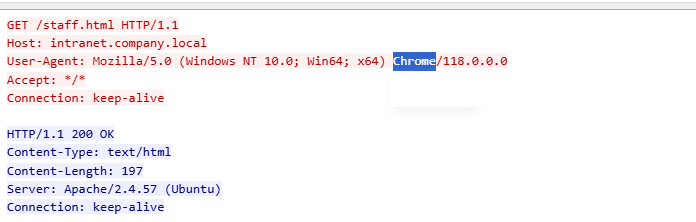

# 🕵️ Lab 1: Follow TCP Stream

### Finding a secret hidden in an HTTP response

---

## 🎬 Scenario

A staff member opened **three pages** on the company intranet. An admin reported
that one page contained a **hidden note**. Traffic was captured on a **SPAN port**,
which mirrors the traffic to the analyst PC without being in the path.

| 🖥️ Host | 📍 IP |
|--------|------|
| 🦈 SOC Analyst (Wireshark) | `192.168.10.10` |
| 💻 Staff PC | `192.168.10.45` |
| 🖥️ Intranet Server | `192.168.10.20` |

## 🧰 Tools & skills

`http.request` · `http.server` · `tcp.stream eq N` · Follow TCP Stream · HTTP headers · IOC extraction · redaction

---

## 🔍 Walkthrough

### 1️⃣ Tasks 1-2: find the stream and the page

I filtered with `http.request`, which showed three GET requests:
`/index.html`, `/help.html` and `/staff.html`. Each one uses its own TCP
connection, so each is a separate stream. I used **Follow TCP Stream** on each
and read the server response. The hidden note was in **`/staff.html`**,
**stream `<N>`**, inside an **HTML comment**.

### 2️⃣ Task 3: the hostname 🏷️
The `Host` header shows `intranet.company.local`, which matches the DNS query at
the start of the capture.

### 3️⃣ Task 4: web server software 🖥️
The `Server` header shows **`Apache/2.4.57 (Ubuntu)`**.

### 4️⃣ Task 5: the browser 🌐
The `User-Agent` header shows **Chrome 118** on **Windows 10** (64-bit).

### 5️⃣ Task 6: HTTP version 📡
The request line shows `HTTP/1.1`, with `Connection: keep-alive`.

### 6️⃣ Tasks 7-8: backup server and access code 🔓
An HTML comment left by IT disclosed an internal backup server and an access
code, with the note *"Remove before publishing"*.

| 🔎 Leaked item | 📋 Value |
|---------------|---------|
| 🗄️ Backup server IP | `192.168.10.77` |
| 🔑 Access code | `[REDACTED]` |

---

## 🚩 Key IOCs

| 🏷️ Type | 🔎 Value |
|--------|--------|
| 💻 Staff PC | `192.168.10.45` |
| 🖥️ Intranet server | `192.168.10.20` |
| ⚠️ Exposed internal host | `192.168.10.77` (backup server) |
| 🏷️ Hostname | `intranet.company.local` |
| 📄 Page with the leak | `/staff.html` |
| 🌐 User-Agent | Chrome/118.0.0.0, Windows 10 |
| 🖥️ Server banner | `Apache/2.4.57 (Ubuntu)` |

---

## 🛡️ Security takeaways

| ⚠️ Finding | 💡 Why it matters |
|-----------|------------------|
| 📝 **Information disclosure** | HTML comments are invisible in the browser but travel in the response. Anyone capturing traffic or viewing the source can read them. |
| 🔓 **Plaintext HTTP** | Anyone on the network path can read the content. |
| 🔑 **Credential in page source** | The exposed code must be rotated. |
| 🏷️ **Banner exposure** | The `Server` header reveals software, exact version and OS, which helps an attacker search for matching CVEs. |

> ✅ **Recommendations:** strip comments from production pages, rotate the access
> code, enforce HTTPS on internal sites, review the backup server's access logs,
> hide the server banner, and keep software patched.

## 🧠 What I learned

- 🧵 Follow TCP Stream turns scattered packets into a readable conversation.
- 🔗 `tcp.stream eq N` links the stream view back to the raw packets.
- 🕳️ A single response can reveal software, client, internal hosts and secrets.

---

⬅️ [Back to the Wireshark hub](../README.md) · ➡️ [Next: Lab 2](../lab-02-call-scammer/)

*Lab by [NetworkWalks](https://networkwalks.com/wireshark) · Sensitive values are redacted*

