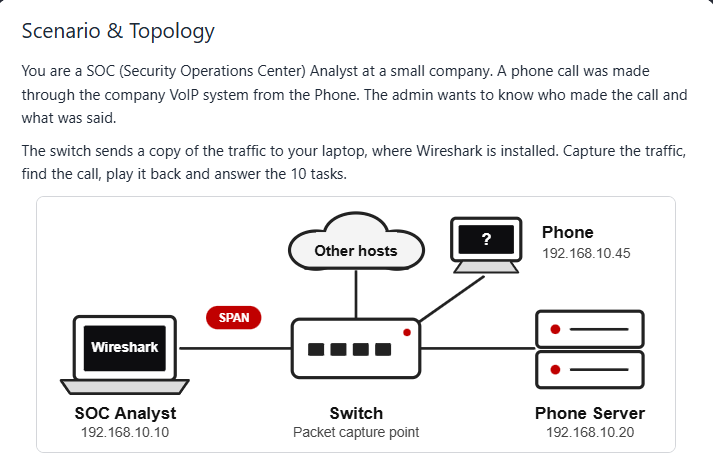
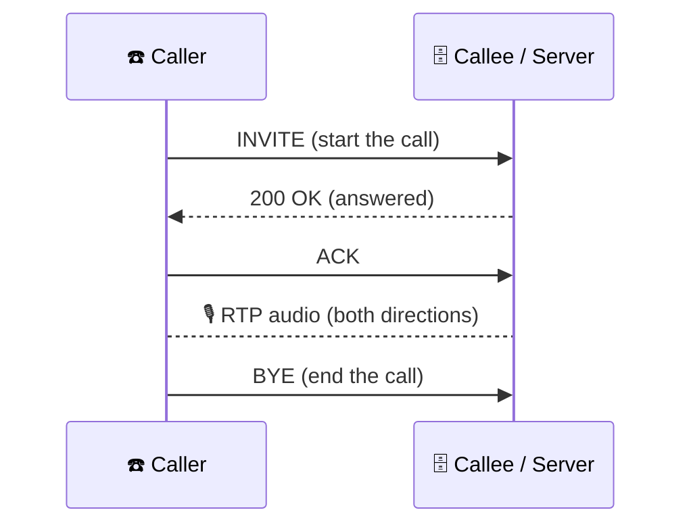
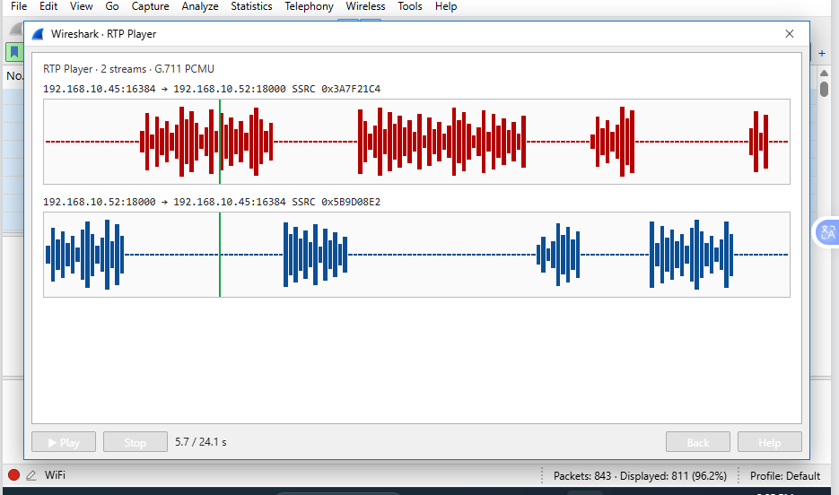

# 📞 Lab 2: Catch the Call Scammer

### Replaying a VoIP call from a packet capture

---

## 🎬 Scenario

A call was made through the company **VoIP system**. The admin wanted to know
**who made the call and what was said**. Traffic was mirrored to my laptop via a
SPAN port, and I rebuilt the call from the capture.

| 🖥️ Host | 📍 IP |
|--------|------|
| 🦈 SOC Analyst (Wireshark) | `192.168.10.10` |
| ☎️ Phone | `192.168.10.45` |
| 🗄️ Phone Server | `192.168.10.20` |
| 👤 Remote party *(not in the diagram)* | `192.168.10.52` |

## 🧰 Tools & skills

`sip` · `rtp` · `sip.Method == "INVITE"` · Telephony ➜ VoIP Calls · Flow Sequence · RTP Player · payload types

## 🧠 How a call looks on the wire

*Typical SIP call flow. SIP carries the signalling, RTP carries the voice.*

---

## 🔍 Walkthrough

### 1️⃣ Task 1: who answered 🎧
I played the call in the **RTP Player**. The stream from `192.168.10.52` spoke
first, and the greeting was: `<what you heard>`.

### 2️⃣ Task 2: number of calls 🔢
`<N>` call(s) listed in Telephony ➜ VoIP Calls.

### 3️⃣ Task 3: call length ⏱️
`<duration>` in VoIP Calls (the RTP Player showed 24.1 s of audio).

### 4️⃣ Task 4: call start method 🚀
**`INVITE`** starts a SIP session. Found with `sip.Method == "INVITE"`.

### 5️⃣ Task 5: who is calling 🗣️
Read from the `From` header of the INVITE: `<caller name>`.

### 6️⃣ Task 6: caller IP address 📍
`<IP>`, from the INVITE source and the SDP in the message body.

### 7️⃣ Task 7: the codec 🎚️
Payload type `0` on an RTP packet: **G.711 PCMU (µ-law)**. The audio is
uncompressed and unencrypted, so it could be rebuilt directly.

### 8️⃣ Task 8: number of RTP packets 📦
Display filter `rtp`, *Displayed* counter: `<N>` packets (both directions),
cross-checked in Telephony ➜ RTP ➜ RTP Streams.

### 9️⃣🔟 Tasks 9-10: sensitive data spoken in the call 💳
A card expiry date and card number were spoken **in the clear** during the call.

| 🔎 Leaked item | 📋 Value |
|---------------|---------|
| 📅 Expiry date | `[REDACTED]` |
| 💳 Card number | `[REDACTED]` |

---

## 🚩 Key IOCs

| 🏷️ Type | 🔎 Value |
|--------|--------|
| 📍 Caller IP | `<IP>` |
| 🗣️ Caller identity (SIP From) | `<name>` |
| 👤 Remote party | `192.168.10.52` (not in the documented topology) |
| 📡 Protocols | SIP (signalling), RTP (audio) |
| 🎚️ Codec | G.711 PCMU, payload type 0 |
| 🔌 RTP ports | `16384` and `18000` |

---

## 🛡️ Security takeaways

| ⚠️ Finding | 💡 Why it matters |
|-----------|------------------|
| 🎧 **Unencrypted VoIP can be replayed** | Anyone on the network path can rebuild the audio and hear everything said, including card numbers. |
| 🎣 **Voice phishing (vishing)** | Card details were obtained by voice. No packet filter can block that, so user training matters. |
| 👤 **Unknown host** | `192.168.10.52` was not in the documented topology and should be investigated. |

> ✅ **Recommendations:** use SRTP and SIP over TLS, segment the voice VLAN,
> monitor for unknown hosts, train staff never to give card details by phone,
> and have the affected card cancelled.

## 🧠 What I learned

- 📞 SIP is the signalling and RTP carries the voice.
- 🎧 Wireshark can reassemble and play back unencrypted calls.
- ✌️ Two methods (filter count and RTP Streams) make a result trustworthy.

---

⬅️ [Previous: Lab 1](../lab-01-follow-tcp-stream/) · 🦈 [Wireshark hub](../README.md) · ➡️ [Next: Lab 3](../lab-03-http-credentials/)

*Lab by [NetworkWalks](https://networkwalks.com/wireshark) · Sensitive values are redacted*

