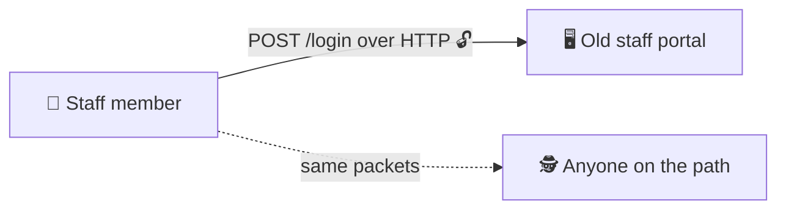
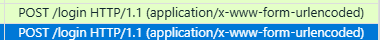

# 🔑 Lab 3: HTTP Plain Text Credentials

### What an observer on the network can read from a login

---

## 🎬 Scenario

A staff member signed in to the **old staff portal**. I analysed the capture to
find the sign-in and show what anyone watching the network could read.

## 🧰 Tools & skills

`http.request.method == "POST"` · `tcp.stream eq N` · Follow TCP Stream · `tcp.stream` column · HTTP headers · redaction

---

## 🔍 Walkthrough

### 1️⃣ Task 1: find the stream 🎯
I filtered with `http.request.method == "POST"`, which showed **two POSTs to
`/login`**. I told them apart using the `Host` header and the server response
(failed vs successful attempt). The staff portal sign-in is in stream `<N>`.

### 2️⃣ Task 2: sign-in protocol 🔓
Plain **HTTP**, not HTTPS. The body is `application/x-www-form-urlencoded`, so the
fields travel as readable `field=value` text.

### 3️⃣ Task 3: HTTP version 📡
`<version>`, from the request line.

### 4️⃣ Task 4: the browser 🌐
`<browser>`, from the `User-Agent` header.

### 5️⃣ Task 5: the hostname 🏷️
`<hostname>`, from the `Host` header.

### 6️⃣ Task 6: web server software 🖥️
`<server banner>`, from the `Server` header in the response.

### 7️⃣ Task 7: the HTTP method 📮
**`POST`**, used to submit the login form.

### 8️⃣ Task 8: number of tries 🔁
`<N>` attempt(s). The capture had two POSTs to `/login`, and I checked each
response to see which one succeeded.

### 9️⃣🔟 Tasks 9-10: username and password 🕵️
Both were readable in the POST body of the stream.

| 🔎 Leaked item | 📋 Value |
|---------------|---------|
| 👤 Username | `[REDACTED]` |
| 🔑 Password | `[REDACTED]` |

---

## 🚩 Key IOCs

| 🏷️ Type | 🔎 Value |
|--------|--------|
| 🔗 Login URL | `/login` |
| 🔓 Protocol | HTTP (cleartext) |
| 🏷️ Hostname | `<hostname>` |
| 🖥️ Server banner | `<server banner>` |
| 🌐 User-Agent | `<browser>` |

---

## 🛡️ Security takeaways

| ⚠️ Finding | 💡 Why it matters |
|-----------|------------------|
| 🔓 **Cleartext credentials** | Anyone on the network path (like a SPAN port) can read the username and password directly. |
| 🕰️ **Legacy system** | The old portal never moved to HTTPS. |
| ♻️ **Password reuse risk** | An exposed password may unlock other accounts. |

> ✅ **Recommendations:** enforce HTTPS with HSTS, retire or upgrade the old
> portal, force a password reset for the exposed account, enable MFA, and review
> the portal logs for logins from unexpected hosts.

## 🧠 What I learned

- 📮 A login form is just a POST, and without TLS its body is plain text.
- 🔎 Comparing two similar requests (host, response) is how you pick the right one.
- 👀 Follow TCP Stream shows exactly what an attacker on the path would see.

---

⬅️ [Previous: Lab 2](../lab-02-call-scammer/) · 🦈 [Wireshark hub](../README.md) · ➡️ [Next: Lab 4](../lab-04-packet-capture/)

*Lab by [NetworkWalks](https://networkwalks.com/wireshark) · Sensitive values are redacted*

