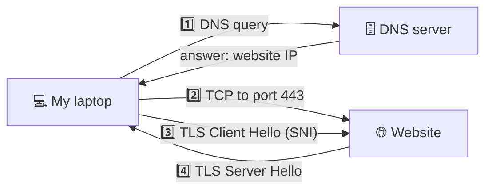
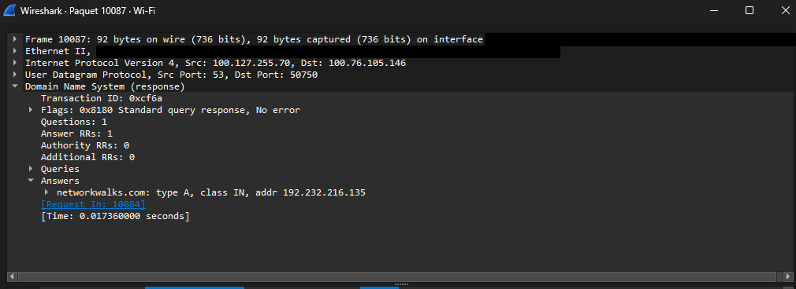
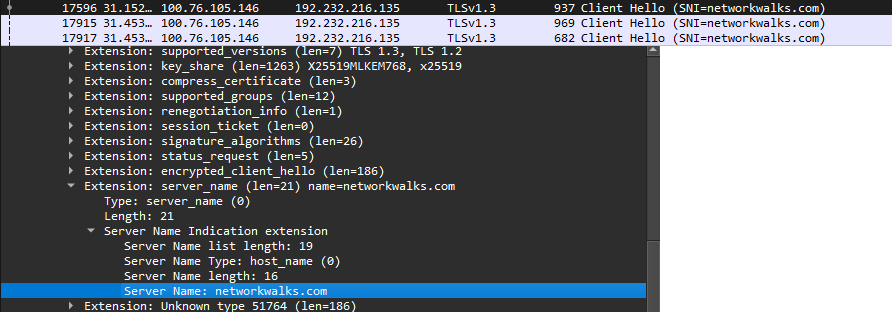
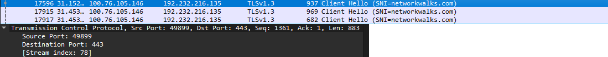

# 📡 Lab 4: Wireshark Packet Capture

### Capturing my own traffic and reading DNS + TLS from the packets

---

## 🎬 Scenario

Capture **my own Wi-Fi traffic** while opening a website, then read the **DNS** and
**TLS** details of that connection from the packets.

## 🧰 Tools & skills

`ipconfig /flushdns` · live capture · `dns.qry.name == "networkwalks.com"` · `tls.handshake.type == 1` · `tls.handshake.type == 2`

---

## 🪜 Method

1. 🧹 Cleared the DNS cache and closed all browser windows, so the laptop could
   not answer from memory and had to send a DNS query.
2. ▶️ Started the capture on the Wi-Fi adapter, opened the site in an Incognito
   window, then stopped the capture.
3. 🔍 Filtered on the site's DNS name to isolate the query and the response.
4. 🤝 Filtered on **Client Hello** (type 1) and **Server Hello** (type 2) to read
   the TLS details.

### 🖼️ Evidence

**🗄️ DNS response**

**🤝 Client Hello with the SNI**

**🔌 TCP destination port**

**✅ Server Hello**

---

## 📋 Findings

| ❓ Question | 🔎 Finding | 📍 Where I found it |
|-----------|----------|-------------------|
| 💻 My laptop IP | `100.76.105.146` | Destination of the DNS response |
| 🗄️ DNS server IP | `100.127.255.70` | Source of the DNS response |
| 🌐 Website IP | `192.232.216.135` | Address field in the DNS answer |
| 🏷️ Server Name (SNI) | `networkwalks.com` | Client Hello, `server_name` extension |
| 🔌 Server port | `443` | TCP destination port of the Client Hello |
| 🔐 TLS version | `TLSv1.3` | Protocol column of the Server Hello |

## 👀 Observations worth noting

- 🔁 **Several Client Hellos went to the same IP.** The browser opened more than
  one connection to `192.232.216.135:443`, each with its own TCP stream (the one
  I analysed is stream 78, source port 49899).
- 🤝 **Request and reply match.** The Client Hello went to `192.232.216.135:443`
  and the Server Hello came back from the same address.
- 👁️ **The SNI is readable.** The Client Hello also carries an
  `encrypted_client_hello` extension, but the site name is still visible in the
  `server_name` field.
- 🚀 **QUIC:** Chrome also uses QUIC (HTTP/3) on port 443 for some sites, so not
  every connection in the capture is TLS over TCP.
- 🏠 **`100.x` addresses are in the carrier-grade NAT range** (`100.64.0.0/10`),
  which suggests the laptop was behind a hotspot or ISP NAT.

---

## 🛡️ Security takeaways

| ⚠️ Finding | 💡 Why it matters |
|-----------|------------------|
| 🔐 **TLS hides content, not the destination** | The site name is still visible to anyone on the path. |
| 🌍 **Plaintext DNS** | Anyone on the path can see which names are looked up. Encrypted DNS (DoH/DoT) closes that gap. |
| 🪪 **Captures hold personal data** | My capture contains other sites and my MAC address, so I publish cropped, redacted screenshots only, never the PCAP. |

---

⬅️ [Previous: Lab 3](../lab-03-http-credentials/) · 🦈 [Wireshark hub](../README.md) · ➡️ [Next: Lab 5](../lab-05-pcap-analysis/)

*Lab by [NetworkWalks](https://networkwalks.com/wireshark)*

