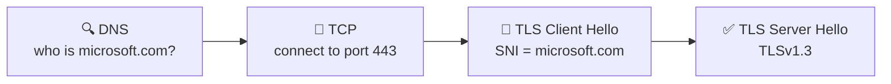
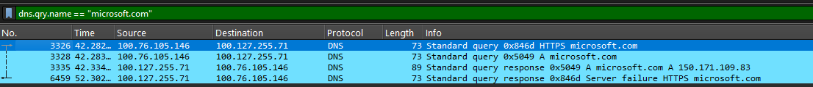
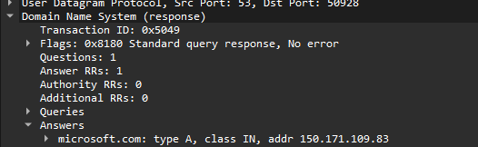
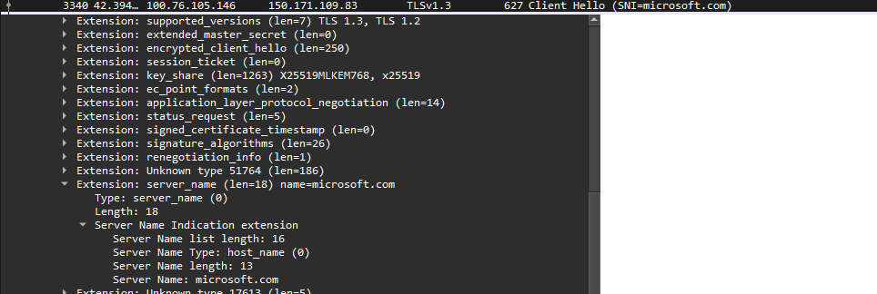
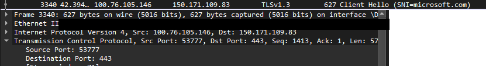
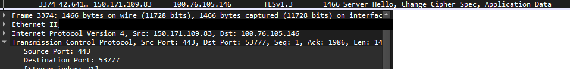

# 🗃️ Lab 5: Wireshark PCAP Analysis

### Answering DNS + TLS questions from a captured session

---

## 🎬 Scenario

I captured **my own traffic** while opening `microsoft.com`, then analysed the
capture to answer the DNS and TLS questions **from the packets alone**.

## 🧰 Tools & skills

Navigating a busy capture · `dns.qry.name == "microsoft.com"` · `tls.handshake.type == 1` · `tls.handshake.type == 2` · A vs HTTPS DNS queries

---

## 🪜 Method

1. 🔍 Filtered on the DNS name: **four packets**, two queries and two responses.
   Besides the A query there was an **HTTPS (type 65)** query, which returned a
   server failure. The A query was answered normally.
2. 💻 Read the source and destination of the A query to identify my laptop and the
   DNS server.
3. 📬 Expanded the A response's *Answers* section to read the returned address.
4. 🤝 Filtered on Client Hello, picked the one for `microsoft.com`, and read the
   SNI and the TCP destination port.
5. ✅ Checked the Server Hello coming back from the same IP to read the TLS version.

### 🖼️ Evidence

**🔍 DNS query and response**

**📬 The DNS answer**

**🤝 Client Hello with the SNI**

**🔌 TCP destination port**

**✅ Server Hello**

---

## 📋 Findings

| ❓ Item | 🔎 Finding |
|--------|----------|
| 💻 Laptop IP | `100.76.105.146` |
| 🗄️ DNS server | `100.127.255.71` |
| 🌐 IP returned for microsoft.com | `150.171.109.83` |
| 🏷️ Server Name (SNI) | `microsoft.com` |
| 🔌 Server port | `443` |
| 🔐 TLS version | `TLSv1.3` |

## 👀 Observations worth noting

- 🔀 **Browsers send two lookups.** The A query succeeded, while the HTTPS (type 65)
  query failed. The page still loaded, so the failure was harmless.
- 🏠 **`100.x` addresses are in the carrier-grade NAT range** (`100.64.0.0/10`),
  which suggests the laptop was behind a hotspot or ISP NAT.
- 🤝 **Request and reply match.** The Client Hello went to `150.171.109.83:443`
  and the Server Hello came back from the same address.

---

## 🛡️ Security takeaways

| ⚠️ Finding | 💡 Why it matters |
|-----------|------------------|
| 🌍 **Plaintext DNS** | Anyone on the path can see which names are looked up. Encrypted DNS (DoH/DoT) closes that gap. |
| 👁️ **SNI is readable** | The destination site is visible even though the traffic is encrypted. |
| 🪪 **Captures hold personal data** | A capture of my own traffic includes other sites and my MAC address, so I publish cropped screenshots only, never the PCAP. |

## 🧠 What I learned

- 🧭 DNS first, then TCP, then the TLS handshake is the standard order of events
  when opening an HTTPS site.
- 🎯 A busy capture needs precise filters to isolate one connection.
- 🔗 Matching a Client Hello to its Server Hello by IP and port confirms you are
  reading the same connection.

---

⬅️ [Previous: Lab 4](../lab-04-packet-capture/) · 🦈 [Wireshark hub](../README.md) · 🧩 [Next: the quiz](../wireshark-quiz/)

*Lab by [NetworkWalks](https://networkwalks.com/wireshark)*

