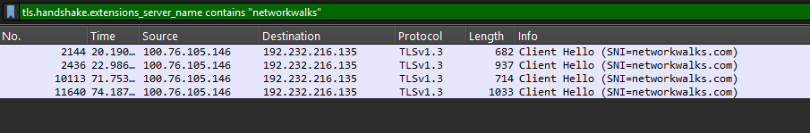
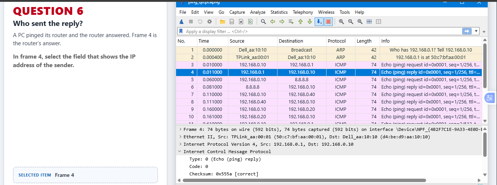
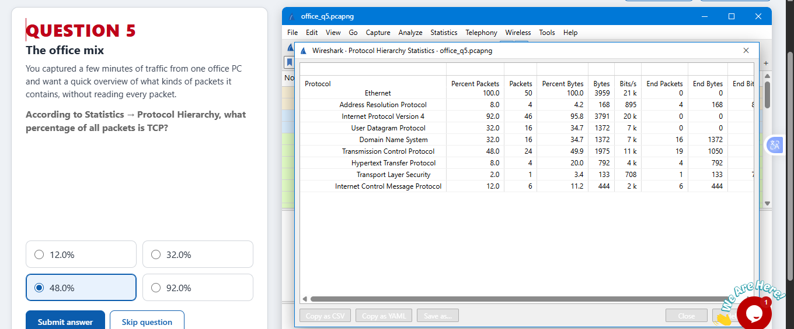
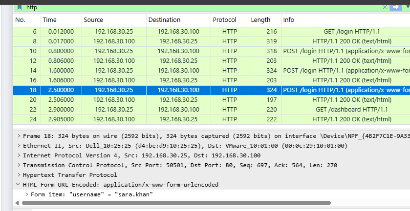

<div align="center">

# 🧩 Wireshark Quiz: Network Traffic Analysis

### 17 challenges · filters, protocol fields, statistics and diagnosis


*For each challenge: the task 🎯, the method 🛠️, the filter 🔍 and a screenshot 📸*

</div>

---

## 🏆 Goals

- 🔍 Master Wireshark **display filters**
- 📋 Read protocol fields (Ethernet, IP, TCP, DNS, HTTP, TLS, FTP, ICMP)
- 🕵️ Use **Follow TCP Stream** and the **Statistics** menu
- 🔓 Spot **sensitive data sent in clear text** and understand why encryption matters
- 🩺 Diagnose network problems (retransmissions, refused connections)

**Requirements:** [Wireshark](https://www.wireshark.org/) 4.x · basic OSI/TCP-IP, TCP handshake, DNS, HTTP

> 🚫 No capture files are included in this repository. Secret words, codes,
> usernames and passwords are shown as `[REDACTED]`.

---

## 📑 Challenge index

| # | 🎯 Challenge | 🏷️ Category | 🔍 Key tool / filter |
|:-:|-------------|------------|---------------------|
| 1 | 🏷️ SNI in the TLS Client Hello | Protocol field | `tls.handshake.extensions_server_name` |
| 2 | 🔢 Packets of one PC | Counting | `ip.addr == 192.168.1.20` |
| 3 | 🥇 First HTTP packet | Packet selection | `http` |
| 4 | 📨 Who sent the reply? | Protocol field | IPv4 layer, `Source Address` |
| 5 | 🤫 The secret word | Follow TCP Stream | `http.request.uri == "/secret.txt"` |
| 6 | 🤝 SYN packets | TCP handshake | `tcp.flags.syn == 1 && tcp.flags.ack == 0` |
| 7 | 👤 Credentials in an HTTP login | Clear-text data | `http.request.method == "POST"` |
| 8 | 🌍 DNS queries for `example.com` | Counting | `dns.flags.response == 0 && dns.qry.name == "example.com"` |
| 9 | 🚪 Packets sent to a web server | Counting | `ip.src == 10.0.0.15 && tcp.dstport == 80` |
| 10 | 📏 How far did the reply travel? | Protocol field | `Time to Live` field |
| 11 | 🗝️ The hidden code | Follow TCP Stream | `http.request.uri == "/backup/readme.txt"` |
| 12 | 📊 Protocol breakdown | Statistics | Protocol Hierarchy |
| 13 | 🏋️ Who moved the most data? | Statistics | Conversations ➜ IPv4 |
| 14 | 🐌 A flaky download | Diagnosis | `tcp.analysis.retransmission` |
| 15 | 🎨 Reading the colours | Coloring rules | `tcp.flags.reset == 1` |
| 16 | 📂 FTP password in the clear | Clear-text data | `ftp.request.command == "PASS"` |
| 17 | ✅ Successful web login | Clear-text data | `frame contains "Welcome back"` |

---

## 🔬 Challenge details

### 1️⃣ 🏷️ Which website name is sent in the TLS Client Hello?

**Method:** filter the Client Hello packets for the target site, then read the Server Name field of the SNI extension.

```
tls.handshake.extensions_server_name contains "networkwalks"
```

📍 Path: `Transport Layer Security ➜ Handshake Protocol: Client Hello ➜ Extension: server_name ➜ Server Name`

**Result:** `networkwalks.com` (no `www.`). Several Client Hello packets carry the same SNI.



> 👁️ The SNI is sent **in clear text** in TLS 1.3 (unless ECH is enabled): anyone observing the network can see which site is visited, even though the content is encrypted.

---

### 2️⃣ 🔢 How many packets involve the PC 192.168.1.20?

`ip.addr` matches the source **or** the destination.

```
ip.addr == 192.168.1.20
```

**Reading the answer:** the `Displayed` counter in the status bar.


---

### 3️⃣ 🥇 Select the first HTTP packet

```
http
```

The first packet in the list (lowest `No.`) is the answer. Plain TCP packets (SYN, ACK) do not count.


---

### 4️⃣ 📨 Who sent the reply? (frame 4)

A PC pinged its router. Frame 4 is the router's reply.

- 🔗 **Ethernet II:** MAC addresses
- 🌐 **Internet Protocol Version 4:** IP addresses (`Src: 192.168.0.1`)

**Result:** select the `Source` field of the IPv4 layer: `192.168.0.1` (the router).



---

### 5️⃣ 🤫 The secret word in `/secret.txt`

```
http.request.uri == "/secret.txt"
```

Right-click the packet ➜ **Follow ➜ TCP Stream**. 🔴 Red text is the request, 🔵 blue text is the response. The secret word is in the response body, after the HTTP headers.

**Result:** `[REDACTED]`


---

### 6️⃣ 🤝 SYN packets

A SYN is the first packet of the TCP handshake: SYN flag set, ACK flag not set.

```
tcp.flags.syn == 1 && tcp.flags.ack == 0
```

Without the ACK condition, SYN-ACK packets would be shown too.


---

### 7️⃣ 👤 Username in an HTTP login

```
http.request.method == "POST"
```

In the details pane: `HTML Form URL Encoded ➜ Form item: "username"`. Alternative: Follow TCP Stream, then read the form fields in the request body.

**Result:** `[REDACTED]`


---

### 8️⃣ 🌍 DNS queries for exactly `example.com`

```
dns.flags.response == 0 && dns.qry.name == "example.com"
```

- `dns.flags.response == 0` ➜ queries only
- `==` instead of `contains` ➜ excludes `www.example.com`
- Retransmissions and all record types (A, AAAA...) are counted


---

### 9️⃣ 🚪 Packets sent by 10.0.0.15 to TCP port 80

```
ip.src == 10.0.0.15 && tcp.dstport == 80
```

Use `ip.src` and `tcp.dstport` (not `ip.addr` / `tcp.port`) to exclude the server's replies. Every TCP packet counts (SYN, ACK, GET...), not only HTTP.


---

### 🔟 📏 How far did the reply travel? (TTL)

The TTL drops by 1 at each router. Common starting values: 64, 128, 255.

- 🏠 A local-network machine replies with a TTL close to its starting value.
- 🌍 `8.8.8.8` (on the Internet) replies with a lower TTL.

In frame 6: `Internet Protocol Version 4 ➜ Time to Live`.


---

### 1️⃣1️⃣ 🗝️ The hidden code in `/backup/readme.txt`

```
http.request.uri == "/backup/readme.txt"
```

⚠️ Trap: a similarly named file holds an outdated code. Use `==` (not `contains`), then Follow TCP Stream, and check that the GET matches the right file.

**Result:** `[REDACTED]`


---

### 1️⃣2️⃣ 📊 Share of TCP in the capture

**Statistics ➜ Protocol Hierarchy**, with no active filter. Read the **Percent Packets** column of the *Transmission Control Protocol* row (not Percent Bytes).



---

### 1️⃣3️⃣ 🏋️ Which pair of hosts exchanged the most data?

**Statistics ➜ Conversations ➜ IPv4 tab**, sorted by **Bytes** in descending order. The IPv4 tab groups traffic by address pair (the TCP tab splits it by port).


---

### 1️⃣4️⃣ 🐌 TCP retransmissions

```
tcp.analysis.retransmission
```

Wireshark flags retransmissions through its TCP analysis. Fast and spurious retransmissions are included. Duplicate ACKs are **not** retransmissions. Cross-check with **Analyze ➜ Expert Information**.


---

### 1️⃣5️⃣ 🎨 Reading the colours: the "TCP RST" rule

```
tcp.flags.reset == 1
```

The `[RST, ACK]` packet is the refused connection. Do not confuse it with the retransmission (*Bad TCP* rule). Rules are listed in **View ➜ Coloring Rules**.


---

### 1️⃣6️⃣ 📂 FTP password in the clear

```
ftp.request.command == "USER" || ftp.request.command == "PASS"
```

The `PASS` that follows the right `USER` is the password you are looking for. Three logins = three TCP streams, so match each `PASS` to its `USER`.

**Result:** `[REDACTED]`


---

### 1️⃣7️⃣ ✅ Which web login succeeded?

The user tried to log in several times over HTTP.

| 📮 POST | 📬 Response | 📏 Size | 🔑 Credentials |
|--------|------------|--------|---------------|
| Frame 10 | Frame 12 | 203 bytes | `[REDACTED]` |
| Frame 14 | Frame 16 | 203 bytes | `[REDACTED]` |
| Frame 18 | Frame 20 | 197 bytes | `[REDACTED]` |

The successful response is different (197 bytes) and is followed by a `GET /dashboard`. Confirm with:

```
frame contains "Welcome back"
```

> 🔎 `frame contains` searches the whole packet, while `http.file_data contains` searches only the HTTP body. Both are useful to confirm which response is the successful one.

🔗 To find the request tied to a response: the `[Request in frame: N]` field in the HTTP layer.

**Result:** the third attempt (frame 18), `[REDACTED]`.



---

## 📝 Filter cheat sheet

| 🎯 Need | 🔍 Filter |
|--------|----------|
| Source **or** destination | `ip.addr == X` |
| Source only | `ip.src == X` |
| Destination port | `tcp.dstport == 80` |
| HTTP requests | `http.request` |
| POST requests | `http.request.method == "POST"` |
| DNS queries (no responses) | `dns.flags.response == 0` |
| TLS Client Hello | `tls.handshake.type == 1` |
| TCP problems | `tcp.analysis.flags` |
| Text search | `frame contains "text"` |

## 🪤 Common pitfalls

1. ↔️ **Direction:** `ip.addr` (both ways) vs `ip.src` / `ip.dst`.
2. 🟰 **`==` vs `contains`:** an exact match avoids false positives (`www.example.com`).
3. 🧹 **Active filter** in Statistics windows: clear the filter or untick *Limit to display filter*.
4. 👯 **Similarly named files or attempts:** always check the exact request.
5. 🔁 **Request vs response:** credentials are in the client's request, not in the server's response.

## 🛡️ Security takeaways

- 🔓 **HTTP, FTP and Telnet send everything in clear text.** Prefer HTTPS, SFTP/FTPS and SSH.
- 👁️ The **SNI** reveals the visited site, even with TLS.
- 🚨 A capture lets you **detect** anomalies (retransmissions, RST, unusual traffic volumes).
- 🖍️ Sensitive values found in captures must be redacted before publishing a report.

## ⚖️ Disclaimer

The captures analysed come from educational exercises. Only analyse traffic you are authorised to capture.

---

<div align="center">

⬅️ [Previous: Lab 5](../lab-05-pcap-analysis/) · 🦈 [Wireshark hub](../README.md)

### 👩‍💻 Author

**`<Your name>`** · [@your-username](https://github.com/your-username)

</div>