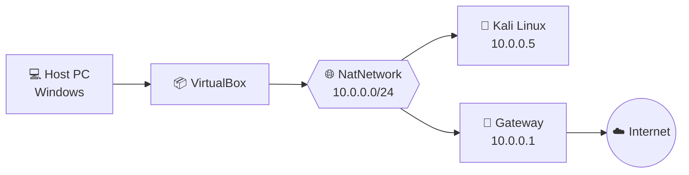
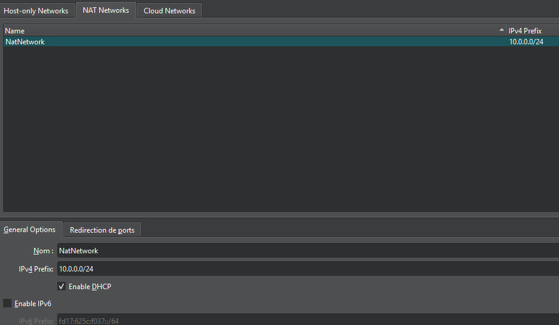
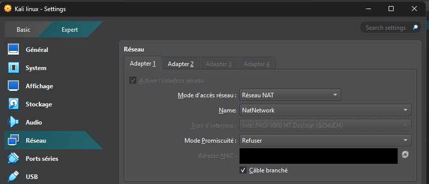
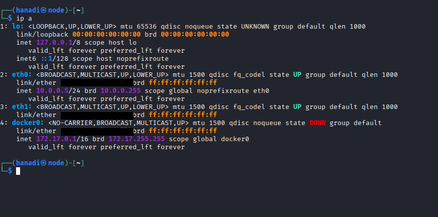
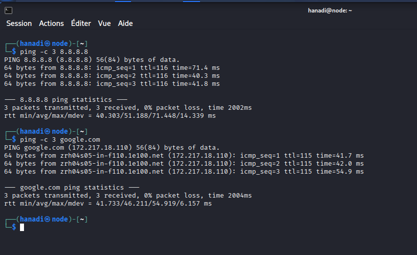
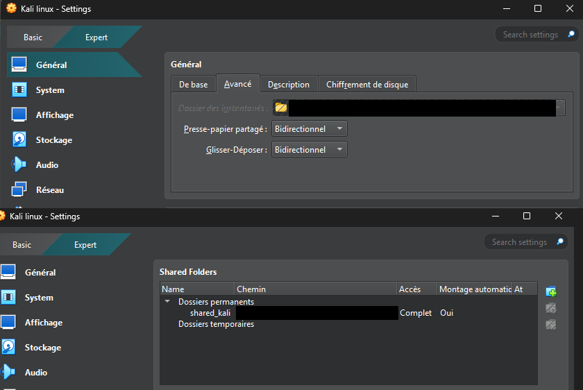
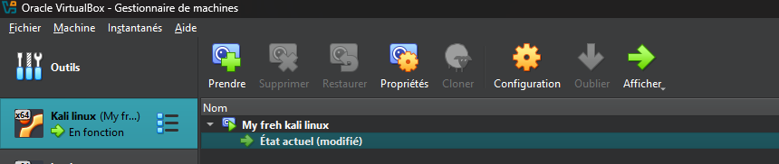

<div align="center">

# 🧪 Week 1: Cybersecurity Lab Environment Setup

### An isolated hacking lab on my own machine: VirtualBox + Kali Linux


</div>

---

## 🎯 Objective

Build a safe, isolated testing lab where I can practise attacking and defending
without touching my real network. This lab is the base for every later exercise.

## ⚡ Quick facts

| | |
|:--|:--|
| 💻 **Host OS** | `<Windows 11>` |
| 📦 **Hypervisor** | VirtualBox `<version>` |
| 🐉 **Guest** | Kali Linux `<version>` (prebuilt VM image) |
| 🧠 **VM resources** | `<RAM>` RAM · `<CPUs>` CPUs |
| 🌐 **Network** | NAT Network `10.0.0.0/24` |
| 📍 **Kali IP** | `10.0.0.5/24` (manual) |

---

## 🗺️ Network design



| ⚙️ Setting | 🔧 Value |
|-----------|---------|
| NAT Network name | `NatNetwork` |
| Prefix | `10.0.0.0/24` · DHCP enabled |
| Kali address | `10.0.0.5/24` (manual) |
| Gateway | `10.0.0.1` |
| DNS | `<8.8.8.8 or 10.0.0.1>` |

---

## ✅ Requirements checklist

| ✔️ | 📋 Requirement | 🛠️ How I met it | 📸 Evidence |
|:-:|---------------|----------------|:----------:|
| ✅ | VirtualBox, latest version | Installed from virtualbox.org | `<screenshot>` |
| ✅ | Kali Linux as a VM, latest version | Imported the prebuilt VirtualBox image | `<screenshot>` |
| ✅ | NAT Network on `10.0.0.0/24` | File ➜ Tools ➜ Network ➜ NAT Networks | `01` |
| ✅ | Clipboard and drag/drop enabled | VM Settings ➜ General ➜ Advanced | `04` |
| ✅ | Shared folder from the host | Dedicated folder `shared_kali` shared in VM Settings ➜ Shared Folders | `04` |
| ✅ | Kali has a fixed IP in `10.0.0.0/24` | Manual IPv4 configuration: `10.0.0.5/24` (`.2` was already used by another machine on the same network) | `03` |
| ✅ | Full Internet access | Verified with ping tests | `05` |

---

## 🪜 Step by step

1. 🗜️ Installed **7-Zip** to extract the Kali image.
2. 📦 Installed **VirtualBox**.
3. 🌐 Created the **NAT Network** with prefix `10.0.0.0/24`.
4. 🐉 Downloaded the **Kali VirtualBox image**, extracted it and imported it.
5. 🔌 Attached **Adapter 1** to the NAT Network.
6. 📍 Set a **manual IPv4** address: `10.0.0.5/24`, gateway `10.0.0.1`, DNS.
7. 📋 Enabled **clipboard and drag/drop**, and added the **shared folder**.
8. 📸 Took a **snapshot** of the clean installation.

### 🖼️ Network configuration

| 🌐 NAT Network | 🔌 VM adapter | 📍 Kali IP |
|:-:|:-:|:-:|
|  |  |  |

---

## 🔬 Verification

```bash
ip a                    # shows 10.0.0.5/24
ip route                # default route via 10.0.0.1
ping -c 3 10.0.0.1      # 1️⃣ gateway reachable
ping -c 3 8.8.8.8       # 2️⃣ internet by IP
ping -c 3 google.com    # 3️⃣ DNS resolution works
```

> 🧭 **Method:** test layer by layer. Gateway first, then an IP address, then a
> name. The first test that fails tells you where the problem is.

**Result:** `<what you saw>` ✅

| 🌍 Internet test | 📋 Integration settings | 📸 Snapshot |
|:-:|:-:|:-:|
|  |  |  |

---

## 🧯 Problems and fixes

<details>
<summary>🔧 <b>Click to open</b>: what to do if Kali has no Internet</summary>

<br>

`<Describe what happened to you. Delete this whole section if you had no problems.>`

Typical checks, in order:
1. 🌐 NAT Network created correctly (`10.0.0.0/24`).
2. ⚙️ Adapter attached to **NAT Network**, with the right name.
3. 👥 No other VM on the same network uses the same address as Kali (`10.0.0.5`).
4. 🔁 Gateway/DNS: try `10.0.0.1` as DNS if `8.8.8.8` fails.

Known issue with VirtualBox 7 and Kali 2026.1 or newer: duplicate address
detection can delay the connection. The fix:

```bash
sudo nmcli connection modify "Wired connection 1" ipv4.dad-timeout 0
sudo nmcli connection down "Wired connection 1"
sudo nmcli connection up "Wired connection 1"
```

</details>

---

## 🔒 Security notes

| ⚠️ Setting | 💡 Why it matters |
|-----------|------------------|
| 🏝️ **NAT Network** | Keeps the VMs on their own subnet, so attack tools are not exposed to my home or office LAN. |
| 👂 **Promiscuous mode: Deny** | Left on the safe default, so the VM cannot see other VMs' traffic. It can be switched to Allow All later for sniffing practice. |
| 📂 **Shared folder + clipboard** | Connects the VM to the host. I share only the dedicated `shared_kali` folder and never put sensitive files in it. |
| 📸 **Snapshots** | Roll back to a clean state after risky experiments. |

---

## 🧠 What I learned

- 🌐 How a **NAT Network** differs from default NAT and bridged mode.
- 📍 Setting a static **IP, gateway and DNS** in Kali.
- 🩺 Diagnosing connectivity **layer by layer**.
- 📸 Why **snapshots** make a lab safe to break.

---

<div align="center">

⬅️ [Back to the main page](../README.md) · ➡️ [Extra work: Wireshark labs](../extra-wireshark-labs/)

*Lab brief by [NetworkWalks](https://www.networkwalks.com) · Sensitive values are redacted*

</div>
